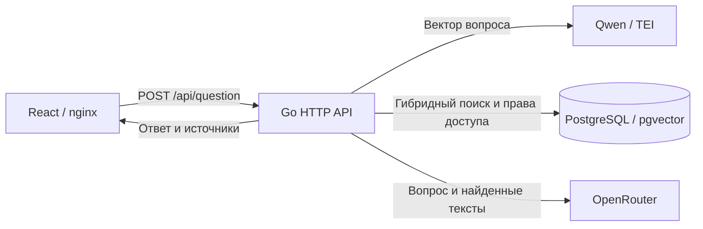

# Avito AI Buddy

AI Buddy — помощник для стажёров, разработанный в рамках хакатона Авито. Он отвечает на вопросы об адаптации и технических темах по базе знаний, показывает использованные материалы и помогает отслеживать первые шаги в команде.

Сервис использует RAG: сначала находит подходящие фрагменты документов, затем передаёт их языковой модели вместе с вопросом. Если поиск не вернул контекст, пользователь получает сообщение о недостатке информации без обращения к LLM.

## Что реализовано

- Чат на русском языке с обработкой ошибок и отображением источников ответа.
- Гибридный поиск: семантическое сходство эмбеддингов и полнотекстовый поиск PostgreSQL с объединением результатов через RRF.
- Фильтрация документов по роли и команде пользователя до ранжирования.
- Раздел «Моя адаптация» с четырьмя первыми шагами и сохранением отметок в браузере.
- Импорт готовых документов и эмбеддингов, миграции БД и CLI для отдельной проверки поиска.
- Локальный запуск всего стенда через Docker Compose.

## Запуск для экспертов

Ниже — основной сценарий проверки на Windows в PowerShell. Все команды выполняются **из корня репозитория**, если не указано другое.

### 1. Подготовить окружение и материалы

Понадобятся:

- Git и доступ к репозиторию.
- Docker Desktop, запущенный в режиме Linux-контейнеров. При запросе установки или обновления WSL 2 нужно завершить настройку и перезапустить Docker Desktop.
- Доступ к Docker Hub, GitHub Container Registry, Hugging Face и OpenRouter из контейнеров.
- Действующий ключ OpenRouter и доступная для него модель.
- Два готовых корпуса от команды: `habr-corpus.json` и `onboarding-corpus.json`.

**Корпуса не входят в Git. До начала проверки их необходимо получить у команды отдельно.** В них уже рассчитаны эмбеддинги: для запуска демо пересчитывать их не требуется. Ключ OpenRouter также передаётся отдельно или создаётся в аккаунте проверяющего; реальные ключи нельзя добавлять в репозиторий.

Go, Node.js, Python и PostgreSQL устанавливать в Windows для этого сценария не нужно. Контейнеры содержат необходимые зависимости; эмбеддер работает на CPU, отдельная видеокарта не требуется.

Проверить готовность Docker:

```powershell
docker version
docker compose version
```

В выводе `docker version` должны присутствовать разделы `Client` и `Server`.

### 2. Получить проект и положить корпуса

```powershell
git clone https://github.com/edic1337/Avito_hackathon-AI_Buddy.git
cd Avito_hackathon-AI_Buddy
git switch main
```

Для существующего клона достаточно перейти в корень проекта и выполнить `git switch main`, затем `git pull --ff-only origin main`. Локальные изменения перед переключением следует сохранить.

Создать каталог `embeddings`, если его нет, и разместить файлы с точными именами:

```text
Avito_hackathon-AI_Buddy/
├── embeddings/
│   ├── habr-corpus.json
│   └── onboarding-corpus.json
├── compose.team.yml
└── scripts/
    ├── setup.ps1
    └── start.ps1
```

Проверить наличие файлов:

```powershell
Test-Path .\embeddings\habr-corpus.json
Test-Path .\embeddings\onboarding-corpus.json
```

Обе команды должны вернуть `True`. Скрипт импорта рассчитан на комплект из **871 документа и 16 413 фрагментов**. Несовпадение количества означает, что нужно проверить версию или полноту полученных корпусов.

### 3. Настроить OpenRouter

```powershell
powershell -ExecutionPolicy Bypass -File .\scripts\setup.ps1
notepad .env.team
```

Скрипт создаёт `.env.team` из `.env.example`, переносит настройки OpenRouter из существующего `.env`, если они там есть, и генерирует токен для связи nginx с API. Повторный запуск сохраняет корректный токен и существующие настройки.

Проверить и сохранить значения:

| Переменная | Что указать |
| --- | --- |
| `OPENROUTER_API_KEY` | Действующий API-ключ OpenRouter |
| `OPENROUTER_API_URL` | `https://openrouter.ai/api/v1/chat/completions` |
| `OPENROUTER_MODEL` | Идентификатор доступной модели; значение из шаблона нужно проверить для своего ключа |
| `BUDDY_PROXY_TOKEN` | Значение, автоматически созданное `setup.ps1`; вручную менять не требуется |

Для командного Docker-запуска используется именно **`.env.team`**. Изменение `.env.example` или старого `.env` не обновляет уже созданный `.env.team`. Адрес БД, коллекция поиска и адрес эмбеддера заданы в `compose.team.yml`; вручную создавать базу или указывать пароль своего PostgreSQL не нужно.

### 4. Запустить сервис и импортировать данные

```powershell
powershell -ExecutionPolicy Bypass -File .\scripts\start.ps1 -ImportCorpus
```

Скрипт собирает frontend и backend, запускает PostgreSQL с pgvector и эмбеддер, применяет миграции, импортирует корпуса и ожидает готовности сервисов. Первый запуск скачивает образы и веса модели, поэтому занимает больше времени, чем последующие. Docker Desktop должен оставаться запущенным.

После сообщения `Ready:` открыть **ссылку, указанную после Ready**.

## Повторный запуск, обновление и остановка

После первого успешного импорта запускать без `-ImportCorpus`:

```powershell
powershell -ExecutionPolicy Bypass -File .\scripts\start.ps1
```

Эта же команда пересобирает приложение после обновления кода и применяет миграции. После обновления интерфейса при необходимости выполнить `Ctrl+F5` в браузере.

После изменения настроек в `.env.team` пересоздать контейнеры приложения:

```powershell
docker compose --env-file .env.team -p ai-buddy-local -f compose.team.yml up -d --force-recreate api frontend
```

Остановить стенд без удаления данных:

```powershell
docker compose --env-file .env.team -p ai-buddy-local -f compose.team.yml stop
```

База хранится в Docker volume `rag_postgres`, веса модели — в `rag_models` (имена томов получают префикс проекта Compose). Обычная остановка их сохраняет. **`docker compose ... down -v` удаляет и базу, и кеш модели**; после этого потребуется повторный импорт и загрузка весов.

## Диагностика

Состояние контейнеров и последние сообщения:

```powershell
docker compose --env-file .env.team -p ai-buddy-local -f compose.team.yml ps
docker compose --env-file .env.team -p ai-buddy-local -f compose.team.yml logs --tail 100 api embedder postgres frontend
```

Проверка HTTP-сервисов:

```powershell
Invoke-RestMethod http://localhost:8080/health
Invoke-WebRequest -UseBasicParsing http://localhost:8081/health
```

`/health` API подтверждает, что HTTP-сервер отвечает. Он не проверяет актуальную доступность OpenRouter, качество поиска или наличие документов в базе.

| Проблема | Что сделать |
| --- | --- |
| Docker не найден или недоступен `Server` | Установить и запустить Docker Desktop, завершить настройку WSL 2, открыть новый терминал |
| `Missing embeddings/...` | Проверить имена файлов и каталог `embeddings` в корне проекта |
| Ошибка количества документов или фрагментов при импорте | Получить согласованный комплект обоих корпусов; не обходить проверку для неполного экспорта |
| `Embedder is not ready` | Посмотреть логи `embedder`: проверить загрузку модели, сеть и доступную память Docker; после устранения причины повторить запуск |
| Порт занят | Освободить `5173`, `8080` или `8081`; для порта БД можно задать `RAG_DB_PORT` в `.env.team` вместо стандартного `65432` |
| Ошибка генерации ответа / OpenRouter 401, 403 или 429 в логах | Проверить ключ, доступ к модели, квоты и сетевую доступность OpenRouter именно из контейнера API |
| Поиск постоянно не находит информацию | Убедиться, что первый запуск был с `-ImportCorpus` и импорт завершился; затем отдельно проверить поиск командой ниже |

Для проверки поиска без генерации ответа:

```powershell
docker compose --env-file .env.team -p ai-buddy-local -f compose.team.yml run --rm rag search -question "Что нужно сделать в первую неделю стажировки?" -role intern
```

Команда возвращает JSON-массив найденных текстов. Нужны работающие БД и эмбеддер; вызова OpenRouter нет. Для проверки всей цепочки в терминале заменить `search` на `ask`.

## Как устроен сервис



1. Браузер отправляет вопрос в nginx. Прокси добавляет серверный токен и передаёт запрос в Go API.
2. API определяет права пользователя, получает эмбеддинг вопроса и ищет доступные документы в PostgreSQL.
3. Поиск объединяет векторное и полнотекстовое ранжирование, применяет порог сходства и ограничение объёма контекста. Между поиском и ModelAPI передаётся `[]string`.
4. ModelAPI отправляет вопрос и контекст в OpenRouter. Интерфейс показывает ответ и список материалов, переданных модели.

Python используется при **подготовке корпуса**: чтении документов, разбиении на фрагменты, расчёте эмбеддингов и экспорте JSON. Для обслуживания вопросов работает Go; Python-пайплайн при каждом запросе не запускается.

| Компонент | Реализация | Локальный адрес |
| --- | --- | --- |
| Интерфейс | React, TypeScript, Vite; раздача через nginx | `http://localhost:5173` |
| HTTP API | Go 1.27, `net/http` | `http://localhost:8080` |
| Эмбеддер | TEI CPU, `Qwen/Qwen3-Embedding-0.6B`, 1024 измерения | `http://localhost:8081` |
| База | PostgreSQL 17, pgvector 0.8.1 | `127.0.0.1:65432` |
| Генерация ответа | Модель, выбранная через OpenRouter | Внешний API |

Все опубликованные порты в локальной конфигурации привязаны к `127.0.0.1`. Контейнеры используют внутренние адреса `postgres:5432`, `embedder:80` и `api:8080`.

## Данные и границы демо

Основной корпус включает 827 публичных статей Хабра, 28 документов Playbook и 16 записей чек-листа адаптации: всего 871 документ и 16 413 фрагментов. Документы и эмбеддинги импортируются в PostgreSQL; во время поиска JSON-файлы напрямую не читаются.

- Каждый вопрос обрабатывается отдельно: предыдущие сообщения не передаются модели. История чата хранится в состоянии страницы и сбрасывается при перезагрузке.
- В интерфейсе один фиксированный чек-лист из четырёх шагов. Следующие этапы и персональная генерация плана пока не реализованы. Эти четыре пункта не равны 16 записям чек-листа в поисковом корпусе.
- Демо работает с общей ролью `intern` без команды. Проверка прав в API реализована, но вход по персональным аккаунтам и SSO не подключены.
- Блок источников показывает материалы, переданные модели, а не автоматически проверенное доказательство каждого утверждения. Качество ответа оценивается по содержимому этих материалов.
- Адреса `attachment:///` и `archive:///` обозначают исходные документы. Скачивание таких вложений через интерфейс не реализовано.
- Публичные статьи и синтетические примеры не являются утверждёнными внутренними регламентами Авито.
- Публичное размещение требует отдельной настройки домена, HTTPS, доступа пользователей, секретов, БД и сети. Текущий Compose и nginx рассчитаны на локальную демонстрацию.

## Структура репозитория

| Путь | Назначение |
| --- | --- |
| `frontend/` | Интерфейс чата и адаптации, конфигурация nginx |
| `backend/cmd/server/main.go` | Точка входа HTTP-сервера |
| `backend/cmd/rag/main.go` | CLI: миграции, импорт, поиск и ответы |
| `backend/FrontendAPI/` | HTTP-контракт, авторизация, обработка ошибок |
| `backend/ModelAPI/` | Обращение к OpenRouter и подготовка RAG-контекста |
| `backend/rag/` | Go-поиск и хранение, миграции; Python-подготовка корпуса |
| `data/kb/` | Исходные материалы базы знаний |
| `embeddings/` | Локальные JSON-экспорты; исключены из Git |
| `postgres/` | SQL-схема и проверки состояния базы |
| `scripts/` | Подготовка конфигурации и запуск стенда |
| `compose.team.yml` | Состав и настройки локального стенда |

## Разработка и проверки

Основной сценарий выше не требует локальных SDK. Для разработки вне контейнеров используются Go 1.27 и Node.js 26.

Тесты backend из корня проекта через Docker:

```powershell
docker run --rm --mount "type=bind,source=$($PWD.Path)\backend,target=/src" -w /src golang:1.27 go test ./...
```

Интеграционные тесты PostgreSQL пропускаются без `TEST_DATABASE_URL`. Для них нужна отдельная тестовая БД с pgvector; успешный запуск модульных тестов не заменяет проверку полного стенда.

Проверки frontend при установленном Node.js:

```powershell
cd frontend
npm.cmd ci
npm.cmd run build
npm.cmd run lint
node scripts/check-markdown.mjs
```

Для разработки интерфейса при запущенном Docker-стенде выполнить `npm.cmd run dev` в каталоге `frontend`. Vite слушает `http://127.0.0.1:5174` и направляет API-запросы через nginx на порту `5173`.

Подробности для работы над модулями:

- [Контракт HTTP API](backend/specs/question-http.md).
- [Контракт RAG](backend/specs/rag.md).
- [Подготовка корпуса](docs/PROJECT_GUIDE.md) и [формат JSON-экспорта](docs/EXPORT_FORMAT.md).
- [Подготовка эмбеддингов на GPU](docs/RUN_GPU.md) и [материалы онбординга](docs/RUN_ONBOARDING.md).
- [Администрирование PostgreSQL](postgres/README.md).

Эти документы описывают отдельные операции разработки и подготовки данных. Для запуска готового сервиса используйте инструкцию в этом README и `compose.team.yml`.
